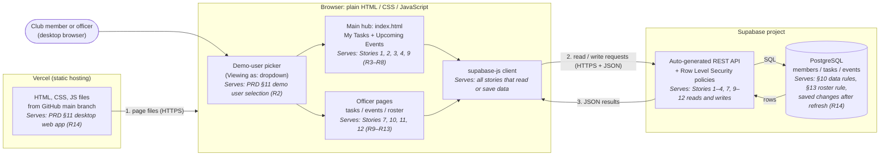
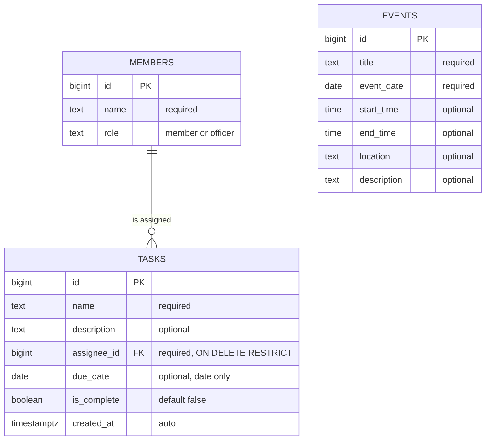
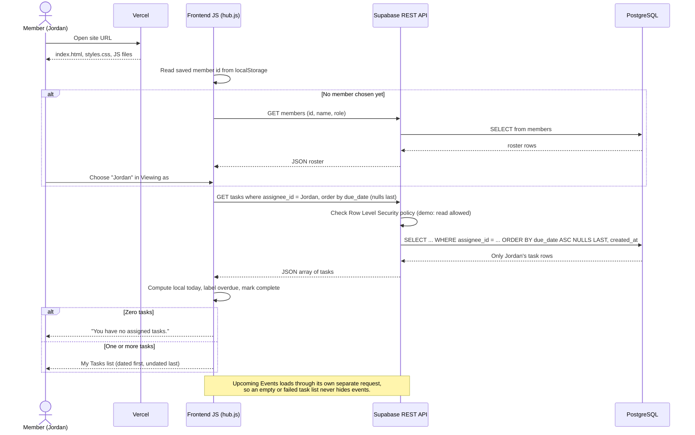

# Architecture Diagram — Club Task and Event Hub

> **Status: planned.** These diagrams describe the intended MVP design from [`../03-architecture.md`](../03-architecture.md). None of these components have been built yet.

GitHub renders the Mermaid code blocks below as diagrams automatically.

---

## 1. System overview

The three planned parts and how data moves between them. There is no custom server and no login service.

**Every box names the requirement it serves.** Story numbers and § sections refer to [`../02-prd.md`](../02-prd.md); R-numbers refer to the requirement list in §2 of [`../03-architecture.md`](../03-architecture.md).

**What each arrow means**

1. When the site is opened, Vercel sends the static page files to the browser. Vercel runs no app code.
2. The pages use the Supabase client to send requests to the Supabase API.
3. Supabase runs the matching SQL against PostgreSQL and sends results back as JSON.

**Deliberately absent:** authentication service, real-time connection, notification or reminder service, email or calendar integrations, custom backend server, serverless functions.

---

## 2. Data model

Three tables. Each task points to exactly one roster member. `ON DELETE RESTRICT` on that link stops a member from being removed while they still have tasks.

`EVENTS` has no relationship to the other tables, because the PRD does not link events to members or tasks.

| Table | Serves |
|---|---|
| `MEMBERS` | Story 12 (roster), PRD §3 roles, demo-user picker (§11) |
| `TASKS` | Stories 1, 2, 7, 9, 10; §10 Tasks; §13 Roster rule via `ON DELETE RESTRICT` |
| `EVENTS` | Stories 3, 11; §10 Events |

---

## 3. Story trace: View Assigned Tasks (Story 1)

*As a club member, I want to see tasks assigned to me so that I know what I am responsible for.*

**Limitation:** the filter `assignee_id = Jordan` is applied because the frontend asks for it. Without login, the database can't verify who is asking (see §6 of [`03-architecture.md`](../03-architecture.md)).
